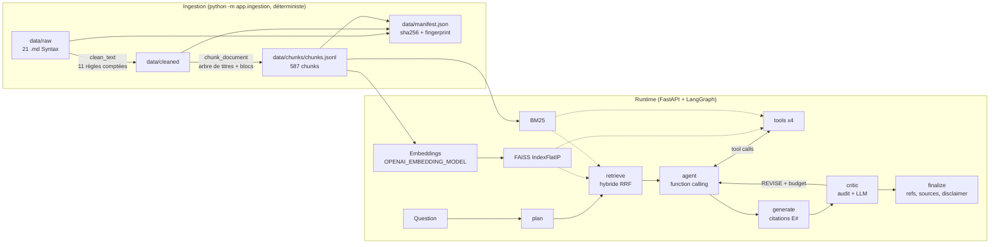

# Architecture et justification des choix (Phase 1)

## Vue d'ensemble



Le graphe exécute exactement les 5 étapes imposées par Syntax : **Plan**
(`plan`), **Retrieve** (`retrieve`), **Use tools** (`agent` ⇄ `tools`),
**Review** (`critic`) et **Answer** (`finalize`). Deux boucles bornées s'y
ajoutent : la boucle de choix d'outils et la boucle de révision pilotée par le
critic.

## 1. Pourquoi LangGraph

Le workflow est un **graphe à état avec transitions conditionnelles** : après
le plan (hors périmètre → réponse directe), après l'agent (encore des appels
d'outils ?) et après le critic (révision ou finalisation). LangGraph modélise
cela nativement avec un `TypedDict` typé et des `add_conditional_edges`, et
rend chaque transition testable et traçable. Une boucle maison aurait
réimplémenté ce routage de façon moins lisible. CrewAI et AutoGen
(multi-agents conversationnels) ajouteraient un non-déterminisme inutile pour
un pipeline aussi structuré.

## 2. Pourquoi FAISS in-memory (et un index *exact*)

587 vecteurs de 1536 dimensions tiennent dans environ 3,6 Mo. Une recherche
exhaustive `IndexFlatIP` sur des vecteurs normalisés L2 donne la **similarité
cosinus exacte** en moins d'une milliseconde, si bien qu'un index approximatif
(IVF, HNSW) n'apporterait que de la perte de rappel et du réglage. FAISS ne
demande ni serveur, ni volume, ni réseau : le conteneur reste autonome. Le
filtrage par métadonnées se fait **dans** l'index via `IDSelectorBatch` plutôt
qu'en sur-récupérant puis en jetant des résultats. Chroma ou Qdrant ajouteraient
un service à opérer sans aucun bénéfice à cette échelle.

## 3. Séparation raw / cleaned / chunks (lignage)

`data/raw` n'est **jamais modifié** : c'est la copie exacte du paquet Syntax.
`data/cleaned` est ce qui est découpé et cité, et chaque chunk vérifie
`cleaned[start_char:end_char] == text` (testé sur les 587 chunks). Le
`manifest.json` enregistre le sha256 des fichiers raw et cleaned, les règles
appliquées avec leur nombre d'occurrences par document, les paramètres et une
**empreinte** (fingerprint). Au démarrage, l'API compare cette empreinte au
corpus et reconstruit automatiquement des artefacts périmés. La sortie est
déterministe (aucun horodatage) : deux exécutions produisent des fichiers
identiques octet pour octet.

## 4. Stratégie de chunking : structurelle + en-tête contextuel

- **Arbre de titres** : chaque chunk appartient à une seule section feuille et
  porte son fil d'Ariane (`5 WARNINGS AND PRECAUTIONS > 5.3 Increased Risk of
  Bleeding`) ainsi qu'une **clé canonique** (`warnings_precautions`).
- **Blocs sémantiques** : une ligne qui finit par `:` reste collée à la liste
  qui suit, et un tableau n'est jamais séparé de son en-tête. Au-delà de 1500
  caractères, on découpe par lignes, puis par phrases, sans jamais couper une
  négation.
- **En-tête contextuel** (technique dite *contextual retrieval*) : on embedde
  `Warfarin — FDA DailyMed label / Section: 4 CONTRAINDICATIONS` + le texte.
  Un chunk qui ne dit que « Pregnancy » devient alors retrouvable comme
  contre-indication de warfarin. Le texte **cité** reste verbatim.
- **Taille 1500** choisie par mesure (voir ci-dessous). On n'utilise pas
  d'overlap en caractères : il dupliquerait des tokens et couperait des
  phrases, alors que l'en-tête contextuel résout mieux la perte de contexte
  qu'un overlap cherche à compenser.

## 5. Retrieval hybride : dense + BM25 fusionnés par RRF

Les embeddings captent la paraphrase (« blood thinner » ≈ anticoagulant) mais
diluent les termes exacts cliniquement décisifs (`eGFR`, `INR`, `CYP3A4`,
`pimozide`, seuils numériques), pour lesquels BM25 excelle grâce à l'IDF.
**Reciprocal Rank Fusion** (`Σ 1/(60 + rang)`) combine les deux classements
sans calibrer des scores aux échelles incomparables (cosinus contre BM25). Les
scores servent au classement et ne sont jamais présentés comme une
probabilité de vérité.

### Justification mesurée (`python -m scripts.eval_retrieval`, 22 requêtes étiquetées)

| Config | Rappel fichiers@5 | Section hit@5 | MRR |
|---|---:|---:|---:|
| A. Fixe 800/100 (recommandation du cahier) | .875 | .864 | .818 |
| B. + chunking structurel | .938 | .909 | .864 |
| C. + en-tête contextuel | .938 | .955 | .955 |
| **D. + hybride BM25/RRF (retenu)** | **1.000** | **1.000** | **.970** |
| E. Hybride, chunks de 800 | 1.000 | 1.000 | .932 |
| F. Hybride, chunks de 2500 | 1.000 | 1.000 | .970 |
| G. BM25 seul | .875 | .864 | .795 |

Chaque brique apporte un gain mesurable. Ni le dense seul (C) ni le lexical
seul (G) n'atteignent 1.0, ce qui prouve leur complémentarité. 1500 est la plus
petite taille qui atteint le meilleur MRR : 2500 n'apporte rien et envoie plus
de tokens au LLM. Limite assumée : 22 requêtes constituent un petit jeu de test.

## 6. Design des outils (agentique réel)

| Outil | Rôle | Pourquoi il est distinct |
|---|---|---|
| `search_corpus` | recherche hybride classée, filtres optionnels | faits précis, interaction citée dans le label *de l'autre* médicament |
| `get_drug_section` | section canonique **complète**, non classée | exhaustivité : un top-k peut rater un élément de liste |
| `compare_drugs` | même section pour 2 à 4 médicaments, groupée | comparaisons ; organise les preuves sans conclure |
| `list_sections` | plan des documents d'un médicament | découverte quand l'emplacement est inconnu |

Le modèle reçoit les 4 schémas (générés depuis Pydantic) via le **function
calling natif OpenAI** et décide lui-même quels outils appeler, avec quels
arguments et combien de fois (appels parallèles autorisés). Aucune règle par
mot-clé n'existe dans le code. Le premier tour utilise
`tool_choice="required"` : l'étape « use tools » a toujours lieu, mais *quel*
outil appeler reste le choix du modèle. Les arguments sont validés par
Pydantic avant exécution, et toute erreur (argument invalide, médicament
inconnu, section absente) est renvoyée à l'agent sous forme de message
actionnable (« sections disponibles : … »). Garde-fous : budget d'appels,
nombre de tours borné, déduplication des appels identiques.

Les traces montrent des choix réellement différents selon la question :
`get_drug_section` pour une liste exhaustive, `compare_drugs` pour une
comparaison, `search_corpus` pendant une révision ciblée.

## 7. Design du critic (deux couches, avec droit de veto)

1. **Audit déterministe** (code, ne peut pas halluciner) : validité des ids
   cités, couverture de citation (part des phrases factuelles citées) et
   **contrôle numérique** (tout nombre d'une phrase citée doit figurer dans les
   passages qu'elle cite ; les nombres de la question sont exemptés). C'est la
   défense directe contre le pire échec possible dans ce domaine : une dose ou
   un seuil inventé.
2. **Revue LLM** (structured output strict) : statut de chaque affirmation
   (`supported`, `unsupported`, `misattributed`, `ambiguous`), couverture du
   plan, détection de conseil médical individualisé, verdict `APPROVE`,
   `REVISE` ou `INSUFFICIENT_EVIDENCE`, confiance et réponse corrigée.

L'audit peut **opposer son veto** à un `APPROVE` du LLM. Le verdict est
**exploité par le graphe** : `REVISE` renvoie à l'agent avec le feedback, et
l'agent va chercher les preuves manquantes avant de rédiger un nouveau
brouillon (une vraie correction, et non une ré-exécution du même retrieval).
Une fois le budget épuisé, la réponse corrigée par le critic est utilisée (si
ses citations sont valides) avec le statut `answered_with_caveats` et les
affirmations signalées sont affichées. Confiance finale = confiance du LLM ×
score d'ancrage déterministe, les deux étant exposés.

## 8. Citations : impossibles à inventer

Chaque passage qui atteint l'agent est enregistré **une seule fois** dans un
registre de preuves (`E1`, `E2`…). Le rédacteur cite ces ids **affirmation
par affirmation**. Le finaliseur les renumérote `[1]`, `[2]` et **supprime**
tout id absent du registre. Ainsi, une citation pointe toujours vers un
passage effectivement récupéré, avec son fichier, sa section, son `chunk_id`
et un extrait verbatim.

## 9. Traçabilité

Un `Tracer` par requête est passé aux nœuds via la `config` de LangGraph
(thread-safe, le graphe compilé étant partagé). Chaque étape émet un événement
structuré : `request_received`, `plan_created`, `retrieval_completed`
(requêtes, chunk ids, scores cosinus, BM25 et RRF), `tool_selected` (outils et
arguments choisis par le modèle), `tool_executed`, `agent_ready`,
`draft_created`, `critic_completed` (verdict, veto, audit, affirmations
signalées), `revision_requested` et `answer_emitted`. Le tout est complété
par la latence et les tokens de chaque appel LLM. Les événements sont :
(1) loggés en JSON sur stdout, (2) diffusés en direct à l'interface (SSE),
(3) disponibles via `GET /trace/{id}` et (4) persistés dans
`data/traces/<id>.json`. Le raisonnement privé du modèle n'est jamais tracé, et
un filtre retire tout motif ressemblant à une clé.

## 10. Structure des dossiers

```text
app/
  config.py            variables d'environnement uniquement (+ correctifs pour le .env Syntax)
  llm.py               passerelle unique vers le proxy : embeddings, structured outputs, tool calling, retries
  tracing.py           Tracer par requête + TraceStore
  runtime.py           composition root (corpus -> LLM -> retriever -> agent)
  main.py, models.py   FastAPI + contrats Pydantic v2
  ingestion/           taxonomy, cleaner, chunker, pipeline (+ CLI)
  retrieval/           bm25, embedding_cache, hybrid (FAISS + BM25 + RRF)
  agent/               state, prompts, planner, tools, evidence, critic, graph
  static/              frontend HTML/CSS/JS vanilla
data/                  raw/ cleaned/ chunks/ manifest.json (versionnés) ; cache/ traces/ (ignorés)
eval/                  requêtes étiquetées pour le retrieval
scripts/               eval_retrieval.py, run_eval_questions.py
tests/                 55 tests hors ligne (LLM scripté, embeddings factices)
docs/                  résultats d'évaluation + walkthrough technique
```

## 11. Robustesse

- `/health` répond 200 immédiatement ; l'index est construit en arrière-plan
  (`starting` → `ok`, ou `degraded` avec la cause, sans secret).
- Retries avec backoff sur 429/5xx du proxy ; repli JSON mode si les
  structured outputs stricts sont indisponibles.
- Toutes les boucles sont bornées (tours d'agent, appels d'outils, révisions,
  `recursion_limit`).
- Questions hors périmètre ou médicament absent du corpus : réponse explicite
  sans appel d'outil.
- Image Docker multi-stage, utilisateur non-root, `HEALTHCHECK`, `.env` exclu
  de l'image et du dépôt.
