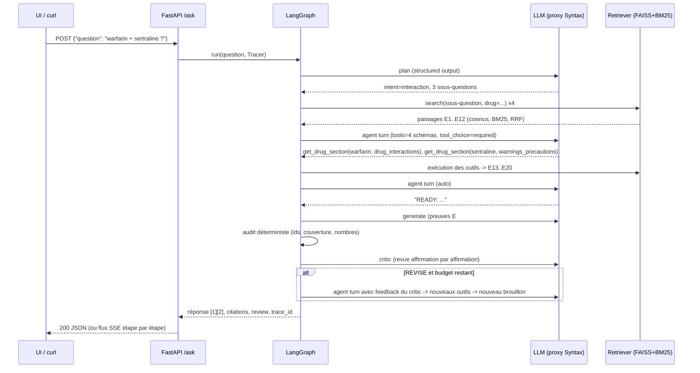

# Walkthrough technique (pour la soutenance)

Ce document explique chaque module : son rôle, ses entrées et sorties, les
erreurs qu'il gère, les alternatives écartées et ses tests. Il se termine par
les concepts clés, un diagramme de séquence et des questions d'entretien
probables avec leurs réponses.

---

## 1. Diagramme de séquence (une question multi-hop)

---

## 2. Modules

### `app/config.py` — configuration
- **Rôle** : lire **uniquement** l'environnement, puis valider et typer
  (`Settings`, dataclass immuable).
- **Particularités** : accepte `OPENAI_BASE_UR` (faute présente dans le `.env`
  Syntax) et retire les guillemets transmis par `docker --env-file`.
- **Erreurs** : variable manquante ou nombre invalide → `ConfigurationError`.
  L'API reste en `degraded`, `/health` répond toujours 200.
- **Tests** : `tests/test_config_and_security.py`.

### `app/llm.py` — passerelle LLM
- **Rôle** : point unique d'accès au proxy. `embed()` (par lots de 128,
  normalisation L2), `structured()` (sortie JSON-schema stricte validée par
  Pydantic, avec repli JSON mode), `tool_turn()` (function calling natif,
  appels parallèles).
- **Pourquoi** : un seul endroit pour les timeouts, les retries
  (`max_retries=6`, le proxy renvoyant des 429 « cooldown »), le comptage des
  tokens dans la trace, et une seule couture à remplacer dans les tests.
- **Alternative écartée** : `langchain-openai`. Ce serait une couche de plus,
  alors que le SDK OpenAI est celui imposé par Syntax.

### `app/ingestion/` — raw → cleaned → chunks
- `taxonomy.py` : mappe les titres des 3 conventions vers 21 clés canoniques
  (numéros PLR = ordre réglementaire FDA).
- `cleaner.py` : 11 règles regex documentées et **comptées**. Aucune ne touche
  aux mots, aux nombres ni aux négations ; le nettoyage est idempotent.
- `chunker.py` : arbre de titres → blocs (paragraphe, liste, tableau) →
  regroupement jusqu'à 1500 caractères → découpe de repli par lignes puis par
  phrases. `embedding_text` = en-tête contextuel + texte. Offsets exacts dans
  le fichier nettoyé.
- `pipeline.py` : orchestre le tout, écrit `data/cleaned`, `data/chunks`,
  `data/manifest.json` (sha256, règles, paramètres, empreinte) ; `load_corpus`
  recharge les artefacts ou les reconstruit s'ils sont périmés.
- **Commande** : `python -m app.ingestion` (hors ligne, sans clé).
- **Tests** : `tests/test_ingestion.py` (offsets verbatim sur les 587 chunks,
  liste jamais séparée de son intro, faits des questions publiques dans des
  chunks bien étiquetés, artefacts à jour).

### `app/retrieval/` — recherche hybride
- `bm25.py` : Okapi BM25 (k1=1.5, b=0.75) avec racinisation légère
  (`contraindicated` ≈ `contraindications`).
- `embedding_cache.py` : cache adressé par contenu
  (`sha256(modèle + texte)`) ; il accélère les redémarrages, et l'index FAISS
  reste construit en mémoire.
- `hybrid.py` : `IndexFlatIP` (cosinus exact), BM25 et fusion RRF ; filtres
  drug / source / section appliqués **dans** FAISS (`IDSelectorBatch`) ;
  résolution des médicaments par alias extraits du corpus et tolérance aux
  fautes de frappe (`difflib`). `section_chunks()` et `outline()` servent les
  outils.
- **Erreurs** : médicament inconnu → `UnknownDrugError` avec la liste des
  médicaments disponibles.
- **Tests** : `tests/test_retrieval.py`, plus l'évaluation chiffrée
  `scripts/eval_retrieval.py`.

### `app/agent/tools.py` — outils
- 4 outils dont les arguments sont décrits par des modèles Pydantic, eux-mêmes
  convertis en schémas OpenAI (`specs()`).
- `execute(name, raw_json)` : parsing → validation → exécution → `ToolOutcome`
  (`ok`, `empty` ou `error`) avec un message actionnable. Rien ne lève
  d'exception vers le graphe.
- **Tests** : `tests/test_tools.py`.

### `app/agent/planner.py` — plan
- Structured output `Plan` (intent, médicaments, médicaments inconnus,
  sous-questions avec médicament et sections, synthèse). Le prompt reçoit le
  catalogue réel (médicaments et alias, sections).
- **Post-validation** : chaque nom est revérifié contre le corpus ; un nom
  inconnu passe dans `unknown_drugs` (on ne fait jamais confiance au LLM sur
  les noms).

### `app/agent/evidence.py` — registre de preuves
- Attribue un id stable `E#` à chaque chunk récupéré (première apparition).
  Pour le prompt, sélectionne en priorité les preuves trouvées par les outils
  (ciblées) puis par score.

### `app/agent/critic.py` — critic à deux couches
- `audit_answer()` : ids invalides, phrases factuelles non citées, nombres
  absents des passages cités → `grounding_score`.
- `Critic.review()` : revue LLM structurée, puis **veto** déterministe
  (`APPROVE` → `REVISE` si l'audit échoue). Confiance = LLM × audit.
- **Tests** : `tests/test_critic.py` (seuil inventé détecté, nombres de la
  question exemptés…) et `tests/test_graph.py` (veto de bout en bout).

### `app/agent/graph.py` — orchestration LangGraph
- Nœuds : `plan`, `retrieve`, `agent`, `tools`, `generate`, `critic`,
  `prepare_revision`, `finalize`. Trois routeurs conditionnels.
- Budgets : `MAX_AGENT_TURNS`, `MAX_TOOL_CALLS` (par tour de révision),
  `MAX_CRITIC_RETRIES` et `recursion_limit` ; déduplication des appels
  identiques.
- `finalize` : choix du brouillon ou de la réponse corrigée, renumérotation
  `[n]`, suppression des ids inconnus, sources, limitations, disclaimer
  imposé.
- **Tests** : `tests/test_graph.py`, avec un LLM scripté sur le vrai corpus
  (pipeline complet, boucle de révision, veto, citation inconnue retirée, hors
  périmètre, budgets).

### `app/main.py` — API
- `GET /health` (toujours 200), `POST /ask`, `POST /ask/stream` (SSE),
  `GET /trace/{id}`, `GET /corpus`, `GET /` (frontend).
- Initialisation en thread d'arrière-plan avec 3 tentatives (backoff). Erreurs
  : 422 (validation), 503 (pas prêt), 502 (proxy LLM), 500 (autre). Le
  `trace_id` est toujours renvoyé, jamais de stack trace.
- **Tests** : `tests/test_api.py`.

### `app/static/` — frontend
- HTML/CSS/JS vanilla, sans dépendance. Il consomme le flux SSE pour animer les
  6 étapes en direct et affiche la réponse (rendu Markdown sûr : HTML échappé
  d'abord), les citations cliquables avec l'extrait cité, la revue du critic
  (verdict, confiance, affirmations signalées, audit), les limitations, le
  plan, les outils choisis et la trace brute. Thème clair ou sombre.

---

## 3. Concepts (définition → usage dans le projet → exemple)

| Concept | Définition | Dans ce projet |
|---|---|---|
| Embedding | Vecteur dense représentant le sens d'un texte | `text-embedding-3-small`, 1536 dimensions, un vecteur par `embedding_text` |
| Similarité cosinus | cos(θ) entre deux vecteurs | produit scalaire sur des vecteurs normalisés L2 (`IndexFlatIP`) |
| Chunking | Découpage d'un document en passages indexables | structurel (sections et blocs), 1500 caractères max, en-tête contextuel |
| BM25 | Score lexical TF-IDF saturé et normalisé par la longueur | capte `eGFR`, `INR`, `pimozide`, les seuils |
| RRF | Fusion de classements : Σ 1/(k + rang) | combine dense et BM25 sans calibration (k = 60) |
| Tool calling | Le LLM renvoie des appels de fonctions structurés | 4 outils locaux, choisis et paramétrés par le modèle |
| État LangGraph | Dictionnaire typé transmis de nœud en nœud | `AgentState` : plan, preuves, messages, brouillon, critique… |
| Critic | Vérificateur indépendant de la réponse | audit déterministe + revue LLM, avec veto |
| Structured outputs | Sortie contrainte par un JSON Schema strict | `Plan`, `GeneratedAnswer`, `Critique` |
| SSE | Flux HTTP serveur → client d'événements texte | `/ask/stream` : étapes en direct dans l'interface |
| Docker multi-stage | Construction séparée de l'exécution | venv construit à part, image finale minimale, non-root |

---

## 4. Questions d'entretien probables

**Pourquoi ne pas avoir suivi le chunking 800/100 recommandé ?**
Parce que je l'ai mesuré : MRR de .818 contre .970 pour la configuration
retenue (`docs/RETRIEVAL_EVALUATION_RESULTS.md`). L'overlap en caractères
coupe des phrases ; l'en-tête contextuel résout mieux la perte de contexte.

**Comment prouvez-vous que le choix des outils n'est pas codé en dur ?**
Le code ne contient aucune règle par mot-clé : les 4 schémas sont fournis au
modèle par function calling. Les traces montrent des choix différents selon la
question : `get_drug_section` pour une liste exhaustive, `compare_drugs` pour
une comparaison, `search_corpus` pendant une révision. Seul le *fait*
d'utiliser au moins un outil au premier tour est imposé (`required`), pas
*lequel*.

**Que se passe-t-il si le LLM invente un seuil, par exemple « eGFR < 35 » ?**
L'audit numérique constate que « 35 » n'apparaît pas dans les passages cités :
veto, puis `REVISE` ; le feedback part vers l'agent et le rédacteur. Le test
`test_invented_threshold_is_caught` couvre ce cas.

**Et si le LLM cite un passage inexistant ?**
Le finaliseur retire tout id absent du registre et l'audit le signale
(`invalid_citations`). Voir `test_unknown_citations_are_stripped_from_the_final_answer`.

**Comment évitez-vous les boucles infinies ?**
Les tours d'agent, les appels d'outils (par tour de révision) et les révisions
sont bornés, et LangGraph ajoute un `recursion_limit`. Les appels identiques
sont dédupliqués.

**Pourquoi FAISS et pas une simple matrice NumPy ?**
À cette échelle les deux seraient exacts. FAISS est la stack imposée, apporte
le filtrage natif (`IDSelector`) et passe à l'échelle (on remplacerait
l'index par IVF ou HNSW sans toucher au reste du code).

**Une question hors corpus ?**
Le planner la classe `out_of_scope`, et le graphe court-circuite vers
`finalize` : réponse explicite, liste des médicaments couverts, aucun appel
d'outil, environ 2 s.

**Le score de confiance est-il une probabilité ?**
Non. C'est la confiance auto-déclarée du critic multipliée par un score
d'ancrage déterministe. Il sert de signal ordinal ; les deux composantes sont
exposées.

**Pourquoi un registre `E#` plutôt que citer des noms de fichiers ?**
Pour citer *chaque affirmation* au niveau du passage, et rendre impossible
toute citation inventée : seuls les ids du registre survivent.

**Comment rejouer une réponse ?**
Avec son `trace_id` : `GET /trace/{id}` ou `data/traces/{id}.json` donnent le
plan, les requêtes, les chunk ids et leurs scores, les outils et leurs
arguments, les brouillons, les verdicts et les tokens.
